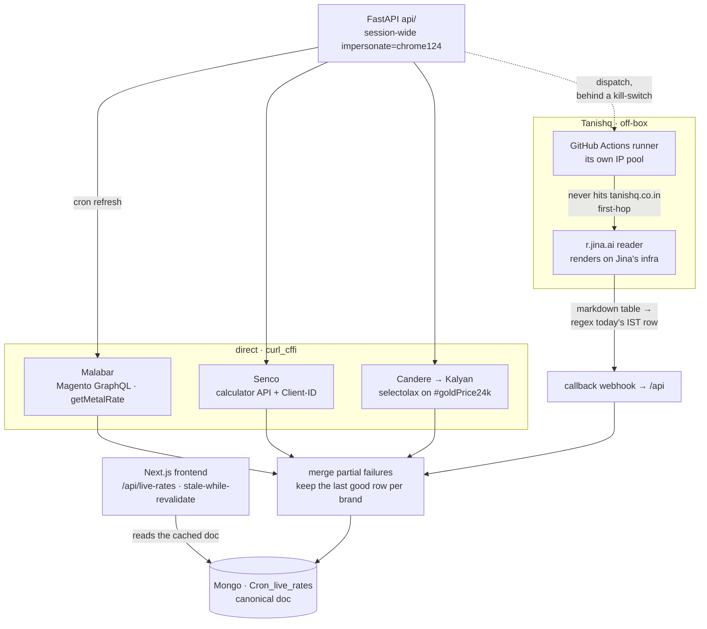
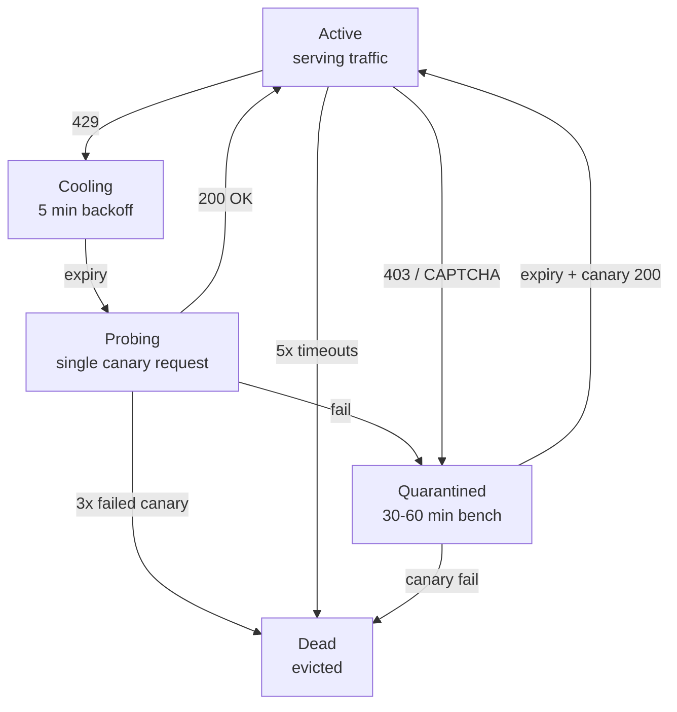

<Lede>
A while back my friend <a href="https://github.com/Amreshhh">Amresh</a> was building <a href="https://pitaara.vercel.app/">Pitaara</a>, a live gold-rates app that tracks prices across big Indian jewellery brands like Tanishq, Malabar, Senco and Candere. The catch: none of these brands offer a public API, and all of them sit behind serious bot protection. I've done my fair share of scraping before, so I jumped in to help. And here's the thing we kept coming back to: <em>these scrapers mostly avoid the fight entirely</em>. No browser farms, no captcha solvers. Just TLS impersonation, the internal JSON these sites already ship to their own frontends, and one very cheeky GitHub Actions trick.
</Lede>

This post is two things: a walkthrough of how [Pitaara](https://pitaara.vercel.app/) works, and the "how to scrape websites in 2026" guide I wish someone had handed me earlier. What anti-bot engines actually inspect at every layer. Why the same scoring model blocks Meta's Muse and xAI's Grok on Amazon. How to build a scraper that doesn't burn through a residential proxy bill.

<Note title="Quick reality check">
Scraping can violate a site's terms of service. A `200 OK` from a residential IP is not consent, and automating logged-in actions like checkout is a completely different legal and ToS class from reading public metadata. The point of this post is understanding how detection layers work and how the web actually fits together, which is useful whether you're pulling data or defending it. Be polite: cache aggressively, respect rate limits, and don't hammer origins.
</Note>

<Toc />

## the project, in one screen

First, what we built. [Pitaara](https://pitaara.vercel.app/) is a FastAPI + Next.js app that serves live gold rates (24K, 22K, 18K, 14K prices per brand) plus an offline-harvested product catalog for making-charge comparisons. The live path is basically three files: `api/live_rates.py`, `api/tanishq_fetcher.py`, and `api/main.py`, backed by `curl_cffi`, `selectolax`, `motor`, and `apscheduler`.

<Figure caption="Pitaara's live-rate path: FastAPI scrapes three brands directly with curl_cffi, Tanishq gets fetched off-box through GitHub Actions and Jina Reader, and everything merges into one canonical Mongo doc.">



</Figure>

Every row in this table was a "challenge faced -> overcome" story, so consider it the trailer for the rest of the post:

| Brand | Surface | What we did | Parse |
| --- | --- | --- | --- |
| **Malabar** | `/graphql-magento?query=getMetalRate…` | `curl_cffi` session hitting the Magento GraphQL the SPA already uses | JSON -> purity map |
| **Senco** | `api.sencogoldanddiamonds.com/calculator/list` | TLS impersonation + full Chrome 124 headers + the `Client-ID` from their frontend bundle | JSON `GOLD[]` |
| **Candere -> Kalyan** | `candere.com/gold-rate-today/india` | `curl_cffi` + `no-cache` + cache-bust query | `selectolax` `#goldPrice24k`, derive 22/18/14K |
| **Tanishq** | Gold-rate page (hostile) | Jina Reader + GitHub Actions isolation, full story below | Markdown table regex for today's IST date |

Now the guide part. Modern anti-bot platforms (Cloudflare, Akamai, AWS WAF, DataDome) don't run one magic check; they run a multi-tiered classification pipeline. Each section below is a gate you'll hit scraping anything non-trivial, in the order you'll hit them.

## challenge 0: "this website doesn't have an api" (yes it does)

This is the single biggest mindset shift, so it goes first. People look for a public API, find none, and conclude they need to spin up a browser and parse HTML. Wrong instinct, man.

==**If a site is a modern React/Next/Vue app, it has an API, it's just "internal."**== The SPA in your browser has to get its data from somewhere, and that somewhere is almost always clean JSON: GraphQL resolvers, REST calculator endpoints, third-party search SaaS, or a hydration blob serialized into the page. The frontend bundle even ships the API keys it uses.

So step zero of scraping anything, before writing a single selector:

<Steps>
<Step title="Open DevTools → Network → XHR/Fetch">
Use the site like a normal human for a minute and watch what the SPA calls when prices load, when you paginate, or when you search.
</Step>
<Step title="Identify the JSON the page already consumes">
For Malabar this was a Magento GraphQL endpoint (`getMetalRate`). For Senco, a calculator API. For catalog pages, a Klevu search SaaS (`eucs27v2.ksearchnet.com/cs/v2/search`). For Next.js product pages, the `#__NEXT_DATA__` script tag, holding the entire price breakup pre-serialized for hydration.
</Step>
<Step title="Lift the auth-ish bits from the frontend">
`Client-ID`s, embedded `apiKeys`, and short-lived cookies: copy them from the browser once and reuse. Senco's `Client-ID` UUID came straight out of their JS bundle.
</Step>
<Step title="Only then consider HTML parsing">
If there's genuinely no JSON (rare), parse HTML with something fast in C like `selectolax` (or `chompjs` for JS objects embedded in HTML), not a browser. One DOM node (`#goldPrice24k`) gave us Candere's 24K rate, and 22/18/14K are just purity ratios away.
</Step>
</Steps>

Internal APIs are built for the site's own frontend, so they're structured, paginated, and hitting them looks way less bot-like than replaying 200 infinite-scroll clicks. You're the same as the SPA at the application layer. The network layer is where you get caught.

## challenge 1: the TLS handshake snitches on you

So you point Python `requests` (or Node `axios`) at the endpoint you found... and instantly get 403'd, even with a browser `User-Agent`. Welcome to the lesson that costs everyone a few hours: **matching the `User-Agent` is cargo cult; the TLS handshake betrays you first (before your HTTP request body is ever read).**

Before an HTTP header ever crosses the wire, your client opens a cryptographic tunnel with a plaintext `ClientHello` packet listing its TLS version, cipher suites, extensions, elliptic curves, and ALPN protocols. Standard libraries like `requests` link against your host OS's OpenSSL, which produces a completely different handshake than Chrome's BoringSSL. You showed up to the costume party with the right mask and the wrong body.

For years, anti-bot systems caught this using **JA3**, which took five `ClientHello` fields and MD5-hashed them. JA3 fell apart for two reasons. Chrome and Safari started sending **GREASE** values, randomized 16-bit dummies like `0x1a1a` that prevent network ossification, and JA3 stripped them out. That threw away the strongest signal separating real browsers from scripts. Minor OS updates also shuffled extension order, which caused false positives.

Today, Cloudflare, Fastly, AWS WAF, and DataDome use **JA4**. Instead of one opaque MD5 hash, JA4 builds a structured, three-part signature (`JA4_a_JA4_b_JA4_c`) that sorts ciphers and extensions and preserves protocol metadata:

- **Google Chrome 120+:** `t13d1516h2_8daaf6152771_02715058788a` (`t13` = TCP + TLS 1.3, `d` = domain SNI, `15` ciphers and `16` extensions including GREASE, `h2` = HTTP/2 ALPN) -> **200 OK**.
- **Python `requests` (OpenSSL):** `t12d171000_906805178657_e2f47285a228` (TLS 1.2, no ALPN) -> **Instant 403**.
- **Go `net/http`:** `t13d1007h2_522197607a70_83e786b72a4c` -> **Flagged as bot**.

<Panel title="JA3 → JA4, in one breath" tone="accent" icon="fingerprint">
A JA3/JA4 hash fingerprints your TLS ClientHello: TLS version, cipher list, extensions, curves, point formats. Chrome and Python's OpenSSL produce completely different hashes *even when the User-Agent lies*. JA4 keeps GREASE and ALPN instead of hashing them away, which is why it survived Chrome's randomization and JA3 didn't.
</Panel>

The fix is [`curl_cffi`](https://github.com/lexiforest/curl_cffi): a Python wrapper around patched libcurl that bypasses Python's `ssl` module and rewrites your `ClientHello` and header order to match a real browser. It's the 80% tool of this whole guide. 100-500 req/s in 20-50 MB of RAM. No JavaScript engine. Pure protocol impersonation.

```python
from curl_cffi.requests import AsyncSession

async with AsyncSession(impersonate="chrome124") as session:
    r = await session.get(
        "https://api.example.com/rates?_ts=...",
        headers={
            "User-Agent": "Mozilla/5.0 ... Chrome/124.0.0.0 ...",
            "Sec-Ch-Ua": '"Chromium";v="124", "Google Chrome";v="124", "Not-A.Brand";v="99"',
            "Origin": "https://example.com",
            "Referer": "https://example.com/",
            # + whatever Client-ID / API key the SPA already embeds
        },
        timeout=15,
    )
    data = r.json()
```

Two details that matter more than they look. Set `impersonate` session-wide so every request matches. Match your `User-Agent` major version to the impersonation profile. Advertising `Chrome/90` in the header while sending a `chrome124` TLS hello is the kind of contradiction a WAF eats for breakfast.

## challenge 2: the WAF wants the full costume (HTTP/2, p0f, and headers)

TLS got you past the front door; now the edge proxy checks whether the rest of your network stack agrees with your disguise.

First, there's Layer 7 header alignment. For Senco's calculator API, there's a comment in Pitaara's source that literally says "Perfect WAF Bypass Headers matching Chrome 124". Every signal tells the same story: `Sec-Ch-Ua` / `Mobile` / `Platform`, same-site `Origin` and `Referer`, `Sec-Fetch-Site: same-site` with `Sec-Fetch-Mode: cors`, the SPA's `Client-ID` UUID, and session-wide `impersonate="chrome124"`. Also in the boring but load-bearing category: CDNs cache rates aggressively, so we append `?_ts=unix` cache-bust params and `no-cache` headers. Otherwise you serve yesterday's gold price with full confidence.

Underneath those headers, though, two deeper protocol checks trip people up when they try to roll their own HTTP clients:

* **HTTP/2 framing (Akamai/Cloudflare H2 fingerprinting):** After TLS finishes, an HTTP/2 client sends a `SETTINGS` frame, a `WINDOW_UPDATE` frame, and colon-prefixed pseudo-headers. Real browsers have rigid defaults: Chrome sets `HEADER_TABLE_SIZE` to `65536` (naive Go/Python sets `4096`), `ENABLE_PUSH` to `0`, `INITIAL_WINDOW_SIZE` to `6291456` (6 MB vs. the default `65535`), and immediately sends a stream-0 `WINDOW_UPDATE` of `15663105` bytes. Even the pseudo-header order is a giveaway: Chrome sends `:method, :authority, :scheme, :path` (`m,a,s,p`), Firefox sends `m,p,a,s`, and standard Go/Node HTTP/2 libraries sort them alphabetically (`a,m,p,s`). `curl_cffi` handles Chrome's HTTP/2 frame order for you; rolling a custom client without matching it gets you Turnstile'd.
* **Passive OS fingerprinting (p0f):** Edge firewalls also inspect your Layer 4 TCP `SYN` packet — specifically IP TTL (`64` on Linux/macOS vs. `128` on Windows), TCP window size (`29200` on Linux vs. `64240` on Windows 11), and TCP options ordering. If your scraper runs on an Ubuntu Linux box (`TTL=64`) while sending a `Windows NT 10.0; Win64; x64` User-Agent, the WAF flags an OS-Transport Inconsistency and bumps your anomaly score straight into block territory. Keep your UA platform aligned with your host OS — or stick to macOS/Linux UAs from Linux boxes.

## challenge 3: when the IP itself is the tell (Tanishq, Amazon, and egress)

You can fake your `User-Agent` (soft signal) and copy Chrome's TLS/H2 fingerprint (medium signal), but **application code cannot rewrite its own source IP** (hard signal). Every IP belongs to an Autonomous System Number (ASN) that threat feeds classify into four buckets: Datacenter (AWS, GCP, Hetzner — high risk by default, because no real shopper browses from a Hetzner rack), Static ISP, Residential (home broadband/fiber), and Mobile 4G/5G (CGNAT pools shared by thousands of phones, which CDNs are terrified to ban outright).

This is why **Amazon started blocking Meta's Muse and xAI's Grok** on the exact same product page (`amazon.com/dp/B0DGHRT7PS`) that loads with a `200 OK` on your laptop. Your laptop isn't smarter; it exits through a home ISP last-mile IP, whereas Muse and Grok exit through cloud datacenter ranges and trigger Amazon's *"Continued access by an unauthorized AI agent violates Amazon's Conditions of Use"* popup.

In Pitaara, **Tanishq** was our version of that wall. It blocked automated access from our serverless host IP hard enough that `curl_cffi` alone wasn't viable. Most people immediately reach for Playwright here. We treated it as a systems problem instead: change *who* fetches, *through what*, and *how the TLS looks*.

<Steps>
<Step title="Jina AI Reader as a fetch proxy">
The fetcher never hits `tanishq.co.in` first-hop. It requests:

```text
https://r.jina.ai/https://www.tanishq.co.in/gold-rate.html?lang=en_IN&_ts=...
```

Jina renders the page on their infrastructure and returns clean markdown, and we regex today's IST date row out of the rate-history table. You inherit Jina's IP reputation and render path without running a single Chromium process locally.
</Step>
<Step title="GitHub Actions for IP isolation">
A scheduled workflow (`.github/workflows/tanishq-live-rates.yaml`) runs `api/github_actions_tanishq.py` on `ubuntu-latest` with its own `AsyncSession(impersonate="chrome124")` and POSTs the parsed result to a callback URL on our main API. Different IP pool than the Vercel/Railway host, no serverless timeout risk, and an `ENABLE_GITHUB_TANISHQ_DISPATCH` kill-switch — the kind of paranoia I aspire to.
</Step>
<Step title="Normalize, then derive">
Scraped 22K gets normalized with digit-length heuristics (per-gram vs. per-10g, because jewellers can never agree on units), and 24/18/14K are derived by purity ratios.
</Step>
</Steps>

### choosing your egress: rented pools, house exit nodes, and cloud browsers

When you do need a residential IP for your own scraper or agent, you don't always have to pay $3–$12/GB for a rented residential proxy pool. Your choice depends on the job:

| Egress / Proxy Class | Cost & Latency | Detection Risk | Best Fit |
| --- | --- | --- | --- |
| **Datacenter** (AWS, OVH, Hetzner) | $0.50–$1.50/GB, 10–40 ms | High (80–95%) | Unprotected APIs, RSS, metadata pre-filtering |
| **Static ISP** | $2–$4/IP/mo, 40–90 ms | Low (10–25%) | Sticky authenticated sessions, headless automation |
| **Rotating Residential** | $3–$12/GB, 150–450 ms | Very Low (< 5%) | Cloudflare/Akamai walls, high-volume rotation on 429 |
| **Mobile (4G/5G CGNAT)** | $15–$40/GB, 250–800 ms | Near Zero (< 1%) | Mobile app reverse-engineering, high-friction targets |
| **Your own house (Tailscale exit / SOCKS5)** | $0 extra | Same as your laptop | Personal agents running on a VPS at human-scale volume |

That last row is the trick proxy vendors won't tell you about. Hosted agents can't route through your house, so they're stuck with datacenter IPs or rented pools. An agent you run on a VPS can exit through your own home machine via a Tailscale exit node (`--advertise-exit-node` on your home server, `--exit-node=<tailnet-ip>` on the VPS). Or even cleaner, so `apt` and Docker keep the VPS's fast route, a process-only `gost` SOCKS5 listener bound to your home server's tailnet IP.

Two hard caveats before you do that:

1. **A home IP only fixes signal 3.** Pointing standard Python `requests` through a residential proxy or a Tailscale exit node still leaks an OpenSSL JA4 hash and gets blocked; you still need `curl_cffi` or a real browser in front of the tunnel.
2. **One house is not a proxy farm.** Rotating residential setups survive rate limits because they have millions of exits, swapping to a fresh IP the second a target returns a `429`. Your home broadband line has one IP — hammer Amazon from it and you're training their bot control on your own shopper address.

If you don't want to stitch TLS, residential IPs, JS rendering, retries, and parsing together yourself, the market has split into two paid shortcuts. **Fetch APIs** like Oxylabs Web API's `/search`, `/scrape`, and dedicated JSON pipes give you public pages as markdown/JSON. **Stealth cloud browsers** like Browserbase, Kernel, and Steel handle durable logged-in sessions with clicks and cookies. Just remember: even with a perfect JA4 and a home IP, behavioral signals after the handshake (cookie jar age, mouse movement, account history) can still trip a wall.

## challenge 4: doing it at scale (catalogs, self-healing fleets, and bandwidth math)

Live rates are the flashy part; catalog harvesting and large datasets are where engineering discipline actually shows up.

In Pitaara's offline catalog harvesters (`backend/fetch_prod_*`), we stuck to the same rule — search APIs and hydration JSON over HTML grids — layered with concurrency control and crash recovery:

| Script family | Trick | Stealth & ops detail |
| --- | --- | --- |
| **Candere / Kalyan Klevu** | POST to `eucs27v2.ksearchnet.com/cs/v2/search` with lifted `apiKeys`, micro-category terms, offset pagination | `impersonate="chrome110"`, 0.3s sleep, SKU dedupe |
| **Senco product inspection** | GET product URL -> parse `#__NEXT_DATA__` hydration JSON for making-charge math | `impersonate="chrome120"`, concurrency 30, bail if body says `"cloudflare / just a moment"` |
| **Malabar bulk** | Product JSON / breakup endpoints with storefront `Origin`/`Referer` | Semaphore 50, Mongo SKU auto-resume |

The ops patterns that keep any scraper alive longer than a week are boring and non-negotiable. Never scrape on every pageview. Mongo holds the canonical doc, a cron refreshes it. Merge partial failures so one brand 403 doesn't wipe the dashboard. Use `stale-while-revalidate` on the frontend. Store state so a crash at item #3,412 doesn't restart from #1.

### why naive loops die at 800 requests

Once you scale past a few hundred pages — say, pulling 10,000 YouTube videos for an AI dataset — a sequential single-IP loop hits a textbook failure curve:

* **0–50 requests:** Honeymoon phase, clean `< 800 ms` latency.
* **50–200 requests:** Soft throttle; latency doubles or triples and Turnstile/reCAPTCHA starts showing up.
* **200–800 requests:** `429 Too Many Requests` saturation and dropped TCP handshakes.
* **800+ requests:** Hard terminal `403` and your IP lands on global threat feeds.

Surviving past that requires four distributed-systems primitives:

1. **Error taxonomy + full-jitter backoff:** Never treat a transient timeout, a `429`, and a `403` the same way, and never sleep at fixed `1.0s` intervals (uniform cadence is a trivial statistical tell). Use full-jitter exponential backoff: `sleep = random.uniform(0, min(30.0, 1.5 * (2 ** attempt)))`.
2. **Sticky vs. rotating sessions:** Rotate IPs per request for stateless, unauthenticated reads (sitemaps, public catalogs, metadata). Pin a sticky session (5–30 minutes) for stateful flows like logins, CSRF tokens, or IP-bound cookies.
3. **A self-healing proxy pool state machine:** Backed by a stateless worker queue (e.g. Redis/BullMQ), model every proxy node as a finite state machine dispatched via Least-Recently-Used (LRU):
   * `Active` -> hits `429` -> `Cooling` (pulled out of rotation for 5 minutes).
   * `Cooling` expires -> `Probing` (gets a single low-priority canary request; `200 OK` returns it to `Active`, failure escalates it).
   * `Active` or `Probing` -> hits `403` / CAPTCHA -> `Quarantined` (benched for 30–60 minutes).
   * `5x` consecutive socket timeouts or `3x` failed canary probes -> `Dead` (evicted permanently).
4. **3-tier filtration (the bandwidth math):** Residential bandwidth ($3–$12/GB) can eat up to 85% of your operating cost. On a 10,000-video YouTube dataset at $5/GB, downloading naive 1080p MP4s (250 MB each = 2.5 TB) costs **$12,500**. Switching to 64 kbps Opus audio (7.5 MB each = 75 GB) drops that to **$375**, and metadata + VTT subtitles alone (120 KB each = 1.2 GB) costs **$6**. Better yet, never stream heavy binaries over residential IPs without qualifying them first:
   * **Phase 1 (Datacenter proxy):** Fetch cheap JSON metadata; filter by language, duration, and views, discarding ~60% of targets.
   * **Phase 2 (Static ISP proxy):** Fetch lightweight transcripts/subtitles; run keyword/quality filters, discarding another ~20%.
   * **Phase 3 (Rotating Residential proxy):** Download audio/media *only* for the top 20%. Your residential bill drops from $12,500 to **under $75** — a >95% cut.

<Figure caption="Self-healing proxy pool: LRU dispatch, canary probes, and quarantine instead of naive retry loops.">



</Figure>

## what to use when: the escalation ladder

Compressing everything above into one rule: **start cheap, escalate only when blocked**.

<Steps>
<Step title="L0: Don't scrape the hard origin at all">
Official APIs, RSS, open data, or a softer aggregator. Fun fact: Amresh's earlier repo, <a href="https://github.com/Amreshhh/Gold-App">Gold-App</a>, used plain `httpx` to scrape `gullak.money` blog posts that had already aggregated making-charge info, shoved the HTML into Gemini JSON mode with Pydantic validation, and saved the result to Mongo. Zero bot fights, LLM absorbs layout churn — staler data, but a brilliant v1.
</Step>
<Step title="L1: Reuse the SPA's own JSON">
GraphQL (Malabar), calculator APIs (Senco), Klevu search (Candere), `#__NEXT_DATA__`. Lift `Client-ID`s and `apiKeys` once from the frontend bundle.
</Step>
<Step title="L2: curl_cffi protocol impersonation">
Session-wide `impersonate`, matching UA major version and OS platform (avoid p0f mismatches), full Chrome header suite, cache-bust params, jittered concurrency. Handles ~90% of what's left.
</Step>
<Step title="L3: Change egress / proxy the fetch">
Jina Reader (`r.jina.ai`), GitHub Actions isolation, a personal Tailscale/SOCKS5 house exit node for personal low-volume agents, or a self-healing residential proxy pool. Pitaara's Tanishq path lives here.
</Step>
<Step title="L4: Real browser / challenge solver">
DrissionPage, Playwright stealth, FlareSolverr as a self-hosted solver microservice, or a stealth cloud browser (Browserbase) for sticky logged-in flows. Not used anywhere in Pitaara's live path, because we engineered around it.
</Step>
</Steps>

| Tool | Layer | JS? | ~req/s | RAM | Use |
| --- | --- | --- | --- | --- | --- |
| **`curl_cffi`** | TLS / HTTP2 | No | 100–500 | 20–50 MB | The default (Pitaara) |
| **`got-scraping` / `cycle-tls`** | TLS / HTTP | No | 80–400 | 30–60 MB | Node equivalent |
| **`selectolax` / `chompjs`** | Parse | N/A | — | tiny | DOM IDs, tables, embedded JS objects |
| **Jina Reader** | Proxy render | Yes (remote) | low | 0 local | Hostile pages (Tanishq) |
| **DrissionPage / Playwright** | Browser CDP | Yes | 2–10 | 200–600 MB/tab | Hard JS walls / sticky sessions |
| **FlareSolverr** | Solver proxy | Yes | 1–5 | 0.5–1 GB | Self-hosted CF solver |
| **`httpx` + Gemini** | Soft HTML + LLM | No | low | API cost | Avoid hard origins (`Gold-App`) |

Efficiency rule of thumb: REI ≈ req/s ÷ (MB + 10 × CPU%). Stay at L1–L2 for 90% of targets. Only boot Chromium when the response body literally says "Just a moment...".

<Kpi cols={3}>
<Stat value="100–500" label="req/s with curl_cffi" tone="ok" />
<Stat value="2–10" label="req/s with a real browser" tone="warn" />
<Stat value="0" label="browsers opened in prod" tone="accent" />
</Kpi>

## the playbook checklist

<Checklist title="Before you scrape anything">
- [ ] Decide whether you need public data or a logged-in session — those are different architectures and different ToS territory.
- [ ] Open DevTools -> Network -> XHR/Fetch first; steal the SPA's own JSON and auth-ish headers (`Client-ID`, `apiKeys`).
- [ ] Stop sending `requests` with a fake `User-Agent` from a cloud VM; use `curl_cffi` with a matching UA major version and OS platform.
- [ ] Parse JSON, `#__NEXT_DATA__`, or `selectolax` instead of rendering a browser.
- [ ] Cache canonically (Mongo/Redis) with partial-failure merging; never scrape on every UI hit.
- [ ] If blocked at the IP layer, change egress (Jina, GitHub Actions, a Tailscale/SOCKS5 house exit for personal low-volume agents, or a self-healing proxy pool) before adding Playwright.
- [ ] Filter cheap metadata on datacenter/ISP IPs before ever pulling heavy payloads over residential bandwidth.
- [ ] Read the target's Conditions of Use before automating anything sensitive, and never burn a single home IP on a high-volume loop.

</Checklist>

<InkBand title="bottom line">
Pitaara works because it impersonates Chrome at the socket, talks to the same APIs the websites themselves use, and for the one hostile origin, moves the fetch off-box through Jina + GitHub Actions. "No API" almost always means "no *documented* API"; the SPA's own JSON is sitting right there. `curl_cffi` is the 80% tool; browsers are the sledgehammer. Reach for the sledgehammer last.
</InkBand>

## credits & sources

- [Pitaara, live app](https://pitaara.vercel.app/) · [repo](https://github.com/Amreshhh/Pitaara), built by [Amresh](https://github.com/Amreshhh) ([LinkedIn](https://www.linkedin.com/in/amreshhh/)), scraping architecture jointly figured out over many "why is this 403ing" calls
- [Gold-App](https://github.com/Amreshhh/Gold-App), the earlier, lazier (affectionate) version
- [lexiforest/curl_cffi](https://github.com/lexiforest/curl_cffi), the library doing all the TLS heavy lifting
- Jina Reader: `https://r.jina.ai/https://…`
- Adjacent tooling worth knowing: FlareSolverr, DrissionPage, got-scraping, chompjs, Browserbase / Kernel / Steel, Oxylabs Web API

<Hand>
shoutout to Amresh for letting me write this up. go poke around pitaara.vercel.app, the rates are live.
</Hand>
